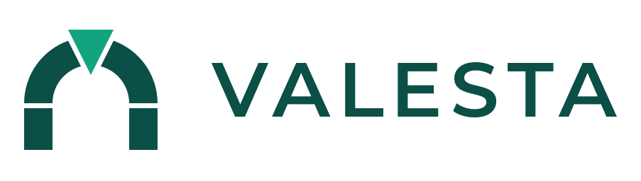
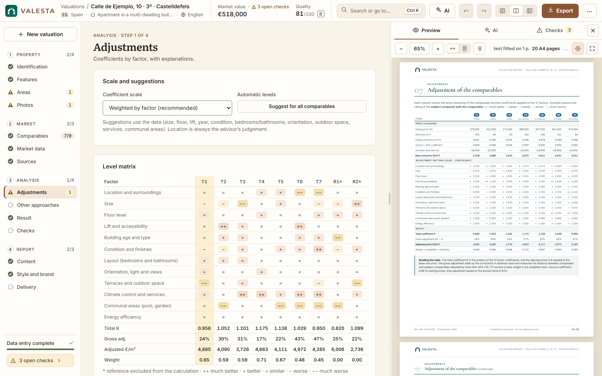
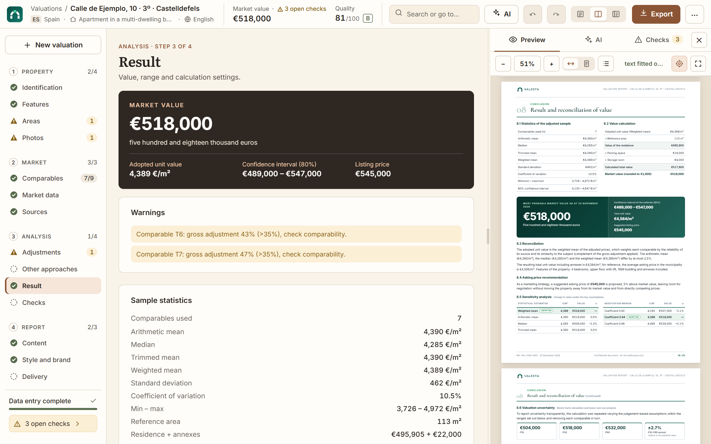
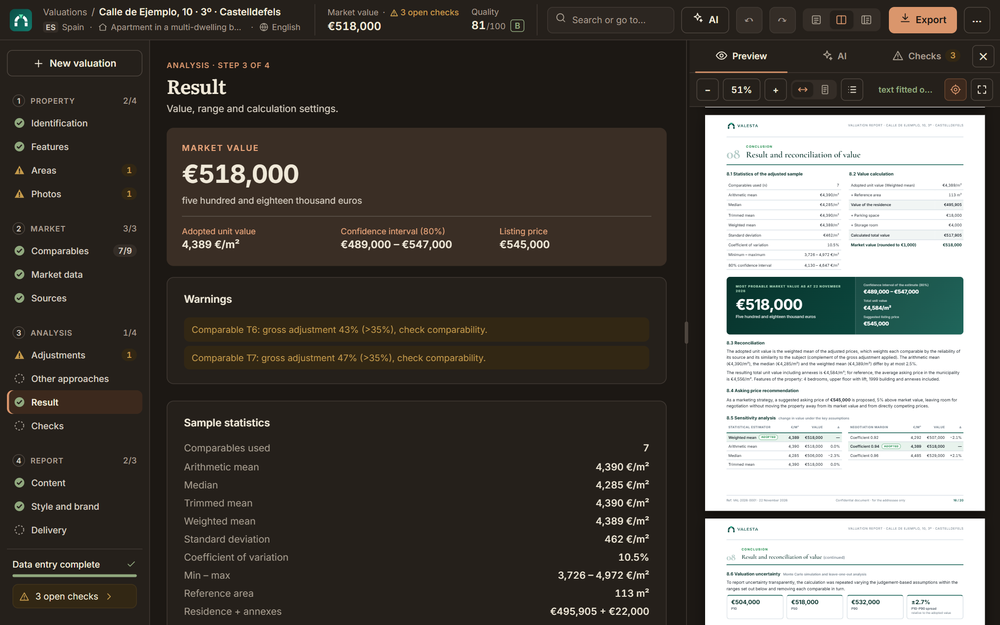
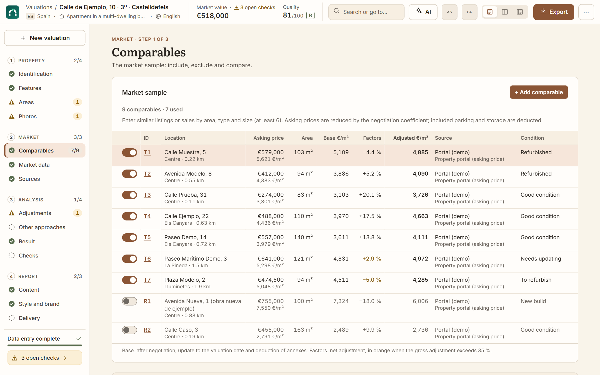
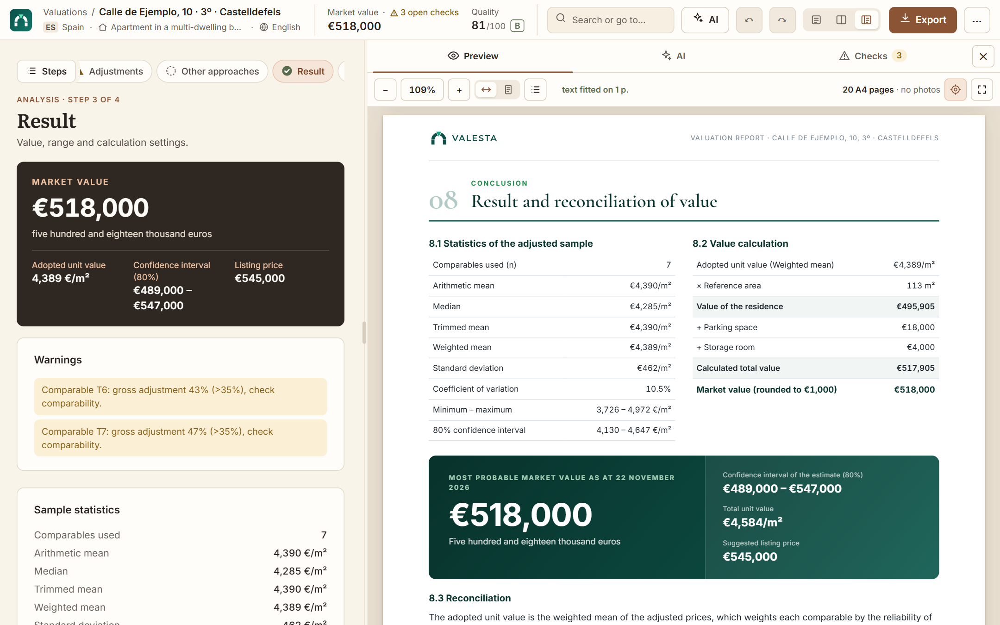
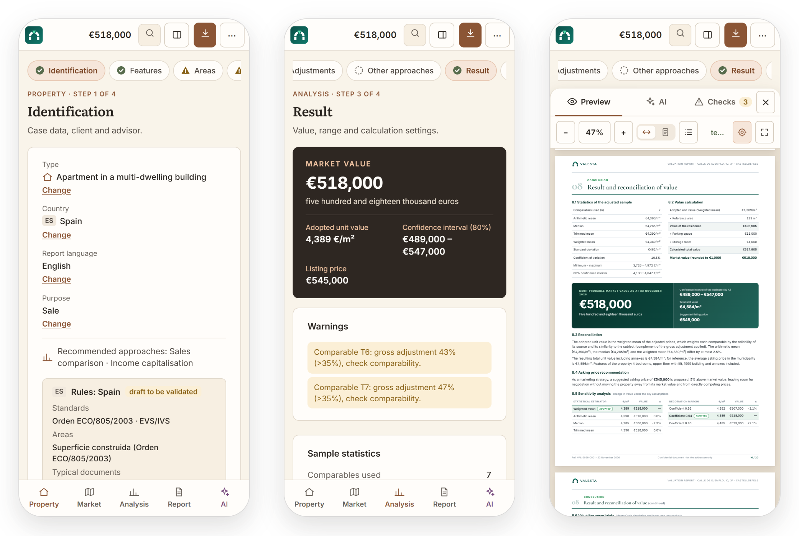
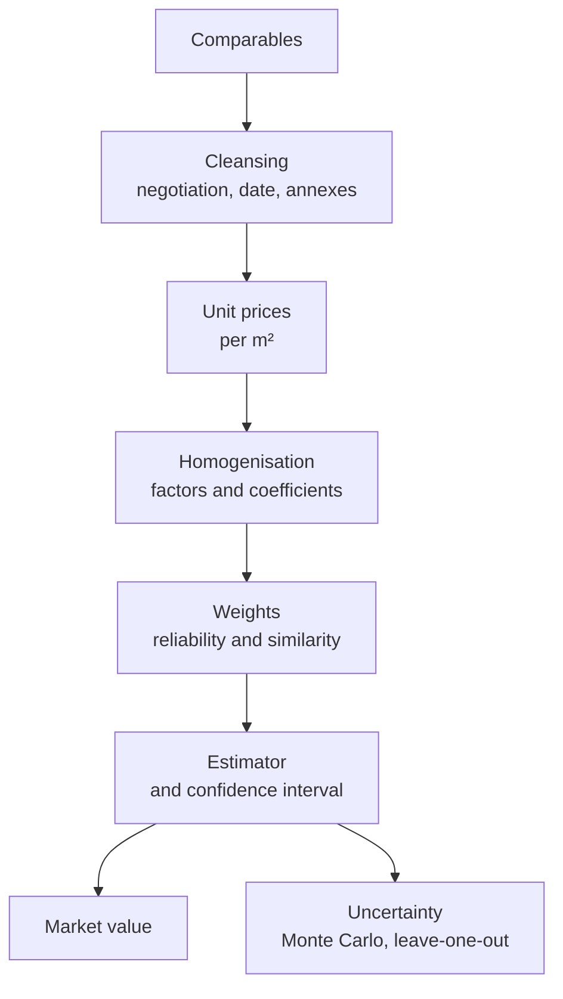
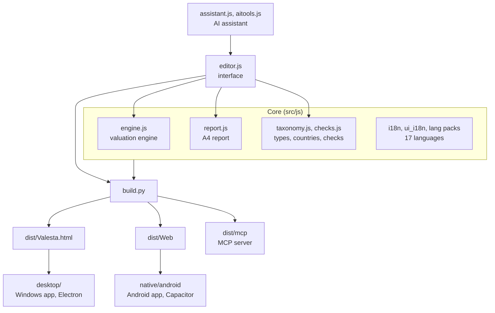
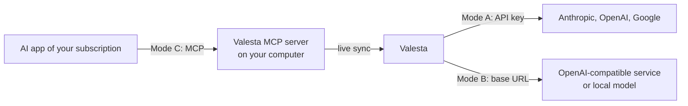

<p align="center">
  <picture>
    <source media="(prefers-color-scheme: dark)" srcset="brand/valesta-logo-reverse.svg">
    
  </picture>
</p>

# Valesta

**Valesta (Value Estate Assistant)** is a property valuation app for professional valuers. It makes A4 valuation
reports with the sales comparison approach, the uncertainty of the value and an AI assistant that the valuer controls.

We develop and test Valesta for **Windows** and **Android**.

[Download](#download) · [Screenshots](#screenshots) · [Features](#features) · [Method](#method) · [Build](#build) ·
[AI assistant](#ai-assistant) · [Documentation](#documentation)



> **Status: version 1.0.0.** Valesta is a support tool. It does not replace the valuer, who stays responsible for the
> data, the method and the conclusions. These items are still open:
>
> - native speakers must review the interface and report texts beyond English, Spanish and Italian;
> - local professionals must validate the 19 country packs;
> - check the terms of use of the map and address services for your use.

## Download

Get the files from the [latest release](https://github.com/domestone-ai/Valesta/releases/latest).

| Platform | File | Requirements |
|---|---|---|
| Windows | `Valesta-Setup-1.1.0.exe` | Windows 10 or 11, 64-bit |
| Android | `Valesta-1.1.0.apk` | Android 7.0 or later |
| AI subscription (optional) | `Valesta-MCP-1.1.0.zip` | Node.js 20 or later. See [AI assistant](#ai-assistant). |

`SHA256SUMS.txt` in the release gives the checksum of each file.

On a Mac, an iPhone, an iPad or any computer with a browser, use the **web app** at
[domestone-ai.github.io/Valesta](https://domestone-ai.github.io/Valesta/). See
[Use on a Mac, iPhone or iPad](#use-on-a-mac-iphone-or-ipad).

### Install on Windows

1. Download `Valesta-Setup-1.1.0.exe`.
2. Open the file.
3. If Windows shows **Windows protected your PC**, select **More info**, then **Run anyway**. This message shows
   because the installer has no code-signing certificate. Do this only for a file from this repository.
4. Follow the steps of the installer.
5. Open Valesta from the Start menu or from the desktop.

### Install on Android

1. On the phone or tablet, download `Valesta-1.1.0.apk`.
2. Open the file.
3. If Android asks, let your browser or file manager install apps.
4. Select **Install**.

### Use on a Mac, iPhone or iPad

1. Open [domestone-ai.github.io/Valesta](https://domestone-ai.github.io/Valesta/) in Safari, Chrome, Edge or Firefox.
2. Install it as an app (optional):
   - Mac with macOS 14 or later, Safari: select **File** › **Add to Dock**.
   - iPhone or iPad, Safari: select **Share** › **Add to Home Screen**.
   - Chrome or Edge: select **Install Valesta** in the address bar or in the menu.
3. Open Valesta from the Dock, the Home Screen or the browser. After the first start, the web app works offline.

The web app keeps your valuations in the browser of that device. A browser can delete the data of a website that
you do not open for some time (Safari: after 7 days of use without a visit). Thus install the web app as in step 2,
and save each valuation to a file with **Save**.

The app works offline. Your valuations stay on your device.

## Screenshots

| Light theme | Dark theme |
|---|---|
|  |  |
| **Comparables**: the comparison view of the sample | **Report**: the A4 document in review mode |
|  |  |

<p align="center"></p>

The screenshots show the demo valuation. Its persons, addresses and comparables are fictitious.

## Features

- **Guided workflow.** Four phases (property, market, analysis, report) with their steps and states. A live preview
  shows the page of the report that the step changes.
- **Comparables.** A comparison view of the sample. Each comparable has its source, date, price, areas and condition.
  You include or exclude each comparable with one switch.
- **Adjustment.** Homogenisation factors for each comparable, with their origin and source. Suggested levels come
  from the data. The location stays your decision.
- **Value and uncertainty.** Weights from reliability and similarity, a choice of estimators, a confidence interval,
  a Monte Carlo simulation (P10–P90) and a leave-one-out analysis.
- **Other approaches.** Income capitalisation, depreciated replacement cost and residual value, with a
  reconciliation by weights.
- **Checks.** Document checks (title, easements, planning, cadastre, energy) with the documents of the country, and a
  quality score from A to E.
- **Reports.** A4 reports in 17 languages, with automatic page fitting, a technical sheet and attached documents.
  Two report models: one for the client, one for banks and valuers. Export to PDF, HTML or a digital file (ZIP).
- **Style and brand.** Agency profiles (white label) that you save, rename, duplicate and move to another device as a
  file. A cover designer with layers (background, shade, pattern, logo and texts) and a contrast check. Font pairs,
  text size, spacing and the logo of the page headers.
- **Countries.** The rules of 19 countries: currency, area basis, standards and typical documents. The packs are
  drafts until local professionals validate them.
- **AI assistant.** It reads documents, photos and dictation and fills the fields. Each change is a proposal that you
  accept or reject. See [AI assistant](#ai-assistant).
- **Interface.** 17 languages, a light, a dark and an automatic theme, keyboard access, and layouts for computer,
  tablet and phone.
- **Privacy.** No account, no server of Domestone, no usage statistics. Outside services work only after you turn
  them on.

## Method

Valesta estimates the market value with the **sales comparison approach with homogenisation coefficients**. The
engine follows these steps:



1. **Cleansing.** Valesta corrects asking prices with the negotiation coefficient. It brings each price to the
   valuation date with the time trend. It takes away the value of annexes, for example a parking space.
2. **Unit prices.** Valesta divides each price by the area of the comparable, on the area basis of the country.
3. **Homogenisation.** For each factor (location, floor, condition, energy class and others), you rate the subject
   and each comparable. Each difference in level changes the unit price by a coefficient δ.
4. **Weights.** Each comparable gets a weight from the reliability of its source and from its similarity to the
   subject. A comparable with a large gross adjustment gets a small weight.
5. **Value.** The estimator (for example the weighted mean) gives the unit value. The confidence interval shows the
   precision of the estimate. Valesta adds the annexes again and rounds the value.
6. **Uncertainty.** A Monte Carlo simulation varies the inputs and gives the P10–P90 range. A leave-one-out analysis
   shows the effect of each comparable.

The income, cost and residual approaches give more values. A reconciliation by weights gives the final value. The
report shows the method that you applied, the sources of the coefficients and the steps of the calculation.

The method relates to IVS 2025, the RICS Red Book and EVS 2025. Valesta reports are not official appraisals for
mortgage lending.

- [Methodology](docs/methodology/README.md): formulas, parameters, sources and the rules of the 19 countries.
- [Technical paper](docs/methodology/paper/valesta-method.en.md): the method as a paper, with a worked example.

## Build

### Requirements

- Python 3.11 or later.
- Node.js 20 or later.
- For the Android app: JDK 21 and the Android SDK (`native/setup_toolchain.py` installs them next to the repository).

### Commands

```text
python -I build.py                                    # dist/: single-file app, web app (PWA), MCP server
for f in tests/*.test.js; do node --test "$f"; done   # unit tests
npm ci --ignore-scripts                               # development tools: ESLint, playwright-core
npx eslint src/js desktop mcp tests e2e               # lint
node --test e2e/*.test.js                             # end-to-end tests in the installed Chrome or Edge
node .github/scripts/compliance-check.mjs             # licences, headers, secrets, data
```

| Output | Command | Result |
|---|---|---|
| Single-file app | `python -I build.py` | `dist/Valesta.html`: open it in a browser, also offline |
| Web app (PWA) | `python -I build.py` | `dist/Web/`: put it on a web server with HTTPS |
| MCP server | `python -I build.py` | `dist/mcp/` |
| Windows app | `npm --prefix desktop ci`, then `npm --prefix desktop run dist` | `dist/windows/Valesta-Setup-1.1.0.exe` |
| Android app (test) | `.\native\build-android.ps1` | `dist/android/Valesta-1.0.0-debug.apk` |
| Android app (release) | `.\native\build-android.ps1 -NewKey` once, then `.\native\build-android.ps1 -Release` | `dist/android/Valesta-1.1.0.apk` and `.aab` |

The release key of the Android app stays outside the repository. The build asks for its password and does not write it
to disk. The iOS shell (`native/ios`) is source code only. We do not build or test it.

### Architecture



More detail: [docs/architecture.md](docs/architecture.md).

### Repository layout

| Folder | Content |
|---|---|
| `src/` | The app: HTML template, styles, JavaScript modules, interface and report texts in 17 languages |
| `tests/`, `e2e/` | Unit tests (Node.js) and end-to-end tests (Chrome or Edge, playwright-core) |
| `desktop/` | Valesta for Windows (Electron) |
| `native/` | Valesta for Android (Capacitor), and the iOS shell (source only) |
| `mcp/` | The MCP server, for AI apps with a subscription |
| `docs/` | Methodology, AI guide, design system and other documents |
| `tools/` | Development tools: fonts, paper, screenshots |
| `brand/` | Logos and icons (not under AGPL-3.0, see [brand/README.md](brand/README.md)) |
| `LICENSES/` | Licence texts of third-party components |

## AI assistant

The AI assistant reads your documents, photos and dictation and fills the fields of the valuation. Each change is a
proposal: you accept it, edit it or reject it. The fields that the AI filled stay marked until you confirm them. The
report states that you used AI.

You can connect the assistant in three modes:

| | Mode A: API key | Mode B: other services and local models | Mode C: MCP and your AI subscription |
|---|---|---|---|
| Provider | Anthropic, OpenAI or Google | OpenAI-compatible services, Ollama, LM Studio | The AI app of your subscription, for example Claude Desktop or Claude Code |
| Cost | You pay the provider for each use | Each use, or no cost for a local model | Your subscription |
| Platforms | Windows, Android | Windows; Android with services on the internet | Windows (computer only) |



### Mode A: connect an API key

1. Get an API key from the provider:
   [Anthropic](https://platform.claude.com/settings/keys), [OpenAI](https://platform.openai.com/api-keys) or
   [Google](https://aistudio.google.com/apikey). A chat subscription does not include API access.
2. In Valesta, select **AI**, then **Settings**.
3. In **Provider**, select the provider.
4. Paste the key into **API key**.
5. Select **Test connection**. Make sure that Valesta shows **Connection works.**

Valesta keeps the key in memory only, unless you select **Remember the key on this device**. Valesta never writes the
key into a project file.

### Mode B: connect another service or a local model

1. In **Settings**, select the provider **OpenAI-compatible / local**.
2. In **Server address (base URL)**, select or write the address, for example `http://localhost:11434/v1` for Ollama.
3. In **Model**, write the name of the model. The model must support tool calls.
4. Select **Test connection**.

A local model keeps all the data on your computer.

### Mode C: connect the MCP server to your AI app

1. Install [Node.js](https://nodejs.org) 20 or later.
2. Download `Valesta-MCP-1.1.0.zip` from the [latest release](https://github.com/domestone-ai/Valesta/releases/latest)
   and extract it, for example to `C:\Valesta`. Or build it: `python -I build.py` makes `dist/mcp`.
3. Add the server to your AI app. For Claude Desktop, add this text to `claude_desktop_config.json`:

   ```json
   {
     "mcpServers": {
       "valesta": { "command": "node", "args": ["C:/Valesta/mcp/valesta-mcp.js", "--http"] }
     }
   }
   ```

   For Claude Code, run this command:

   ```text
   claude mcp add valesta -s user -- node C:/Valesta/mcp/valesta-mcp.js --http
   ```

4. Start the AI app again.
5. Open `http://127.0.0.1:8790` in your browser. The app shows the changes of the AI while they occur.

> **CAUTION:** Do not make the MCP server available on the internet. Other persons could then read and change your
> valuations.

The [AI guide](docs/ai/README.md) gives the full procedures, the other AI apps (Codex, Gemini CLI, Qwen Code, Kimi
CLI, Cursor, VS Code, LM Studio), data protection and the solutions to problems.

## Data and privacy

- Valesta keeps valuations, photos and settings on your device. Domestone receives nothing: no server, no account, no
  usage statistics, no advertising.
- No data go to an outside service until you turn that service on. At the first start, a window asks which services
  to use. Nothing is selected before you choose, and to refuse is as easy as to accept. **Privacy and outside
  services** in the menu shows and changes the choices:
  - map tiles from the national mapping service of the country of the property;
  - address search with OpenStreetMap Nominatim or a service that you choose;
  - public geodata services for the assistant (OpenStreetMap Overpass through Private.coffee, Spanish Cadastre);
  - the AI assistant, with your own provider account.
- Exported HTML reports contain their maps as images. A person who opens them contacts no outside service.
- The MCP server has the same defaults.
- GitHub Pages serves the web app. GitHub records the IP address of each visit for security
  ([GitHub Docs](https://docs.github.com/en/pages/getting-started-with-github-pages/what-is-github-pages)). After
  that, the web app works like the other versions: no data go to an outside service until you turn that service on.
- The demo valuation and the example agencies are fictitious.

## Support and feedback

- **Feedback**: menu ⋯ → **Help** → **Send feedback**. Copy the text, or open a public issue on GitHub. The app sends
  nothing by itself.
- **Support the project**: a star on GitHub helps. The app asks rarely and only after real use: see
  [docs/support-and-feedback.md](docs/support-and-feedback.md).
- **Security problems**: report them in private, as [SECURITY.md](SECURITY.md) tells you.

## Documentation

| Document | Content |
|---|---|
| [docs/methodology/](docs/methodology/README.md) | The valuation method, its sources and the country cards |
| [docs/ai/](docs/ai/README.md) | AI in Valesta: the three modes, step by step |
| [docs/architecture.md](docs/architecture.md) | Modules, build, platforms and data flows |
| [docs/design-system.md](docs/design-system.md) | Colours, type, components and layout of the interface |
| [docs/motion-guidelines.md](docs/motion-guidelines.md) | Motion of the interface |
| [docs/support-and-feedback.md](docs/support-and-feedback.md) | The support invitation and the feedback form |
| [mcp/README.md](mcp/README.md) | The MCP server: options, tools and security |
| [CHANGELOG.md](CHANGELOG.md) | Changes of each version |

## Contributing

We accept contributions under the [Contributor License Agreement](CLA.md). Read [CONTRIBUTING.md](CONTRIBUTING.md)
and the [Code of Conduct](CODE_OF_CONDUCT.md) first.

## Licensing

Valesta is free software: you can redistribute it and/or modify it under the terms of the GNU Affero General Public
License as published by the Free Software Foundation, either version 3 of the License, or (at your option) any later
version.

The names “Domestone” and “Valesta” and their logos are not licensed under AGPL-3.0. As an additional term under
section 7(e) of the AGPL-3.0, Domestone S.r.l. declines to grant rights under trademark law for them. They remain the
property of Domestone S.r.l.

Contributions are accepted only under the project Contributor License Agreement (CLA), which grants Domestone S.r.l.
the right to use, maintain, distribute and relicense contributions in future versions.

See [LICENSE](LICENSE), [NOTICE](NOTICE) (third-party components; their licence texts are in [LICENSES/](LICENSES)),
[CLA.md](CLA.md) and [TRADEMARK_POLICY.md](TRADEMARK_POLICY.md).

Copyright (C) 2026 Domestone S.r.l.
