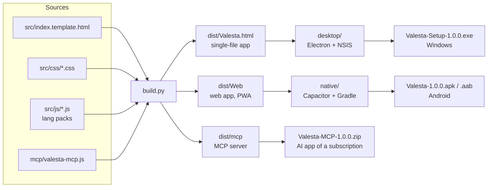
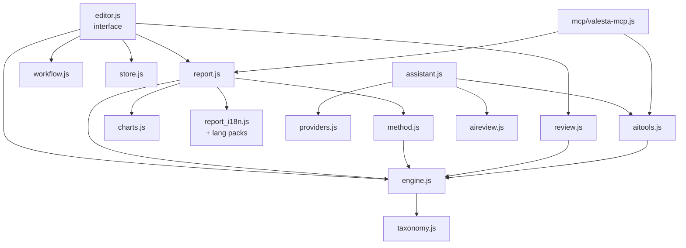
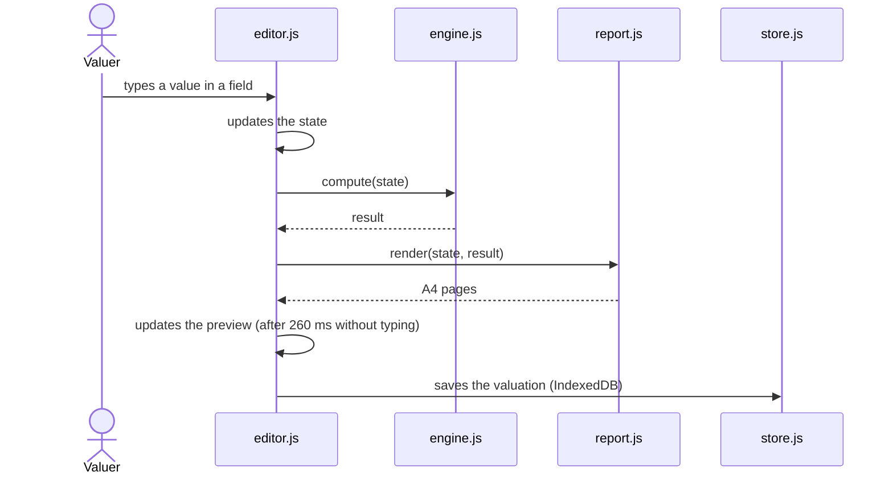
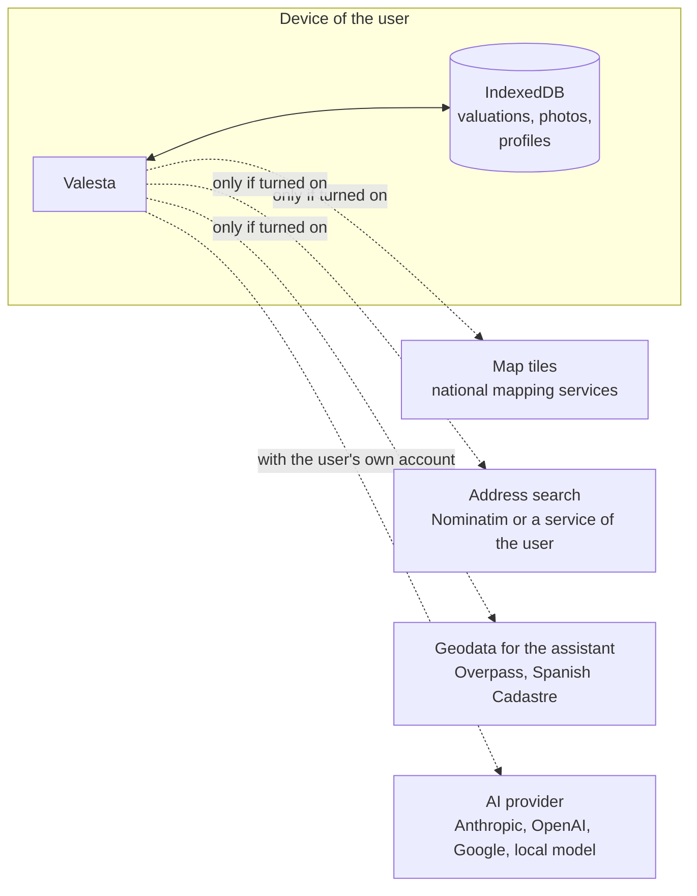

# Architecture

This document describes the structure of Valesta: the modules, the build, the platforms and the data flows. Read it
before you change the structure of the code.

## Overview

Valesta is one web app in plain JavaScript. It has no framework and no runtime dependency. `build.py` puts the
sources into one HTML file. The Windows app and the Android app contain this app. The MCP server uses the same
calculation modules in Node.js.

## Design principles

- **One file, offline.** The app works from `file://` without a network. Fonts, icons and base maps for the demo are
  in the file.
- **Pure calculation.** The engine and the rules have no DOM and no network access. They run in the browser and in
  Node.js, with the same results. The unit tests run them in Node.js.
- **No runtime dependency.** The app uses no third-party JavaScript library. The development tools (ESLint,
  playwright-core), Electron and Capacitor are not part of the app code.
- **Strict Content-Security-Policy.** Only the inline scripts of the build run, by their SHA-256 hash. The build
  stops if a page has an inline event handler.
- **Privacy by default.** No data go to an outside service until the user turns that service on.
- **The valuer decides.** The AI proposes changes. The valuer accepts, edits or rejects each one.

## Modules

All modules are in `src/js/`. The pure modules use the UMD pattern: in the browser they set a global (for example
`MCA`), and in Node.js they export the same object.

| Layer | Module | Responsibility |
|---|---|---|
| Calculation (pure) | `engine.js` | Sales comparison with homogenisation coefficients: cleansing, unit prices, factors, weights, estimators, confidence interval, Monte Carlo, leave-one-out, other approaches, reconciliation, rounding |
| | `method.js` | The facts of the method applied in one valuation, for the report and the method panel |
| | `review.js` | Quality checks and the quality score (0–100, grade A–E), without AI |
| | `workflow.js` | The four phases, their steps, the status of each step and the commands of the command bar |
| | `appcore.js` | Number parsing, data paths, suggestions, validation and migration of projects, safe persistence |
| Data and rules (pure) | `taxonomy.js` | Property types, purposes, approaches and the 19 country packs |
| | `checks.js` | Document checks and the wording of what the valuer verified |
| | `references.js` | Methodological sources with their verification status |
| | `data.js` | The demo valuation (synthetic data) |
| | `profiles.js`, `profiles_assets.js` | Agency profiles: a neutral profile and three fictitious example agencies |
| | `assets.js` | Base map tiles embedded for the demo (IGN España, CC BY 4.0) |
| Languages | `i18n.js`, `numwords.js` | Numbers, currencies, dates and amounts in words in 17 languages |
| | `report_i18n.js`, `lang/report.<code>.js` | Report texts: English, Spanish and Italian, and one pack for each other language |
| | `ui_i18n.js`, `lang-ui/ui.<code>.js` | Interface texts, in the same structure |
| Report | `report.js`, `charts.js` | The A4 pages and the static SVG charts |
| Maps and places | `maps.js`, `mapview.js`, `geo.js`, `geocode.js` | Base map services, the interactive map, coordinate systems and address search |
| Interface | `editor.js` | Screens, steps, forms, live preview, export and the `window.Valesta` API |
| | `layout.js`, `theme.js`, `motion.js` | Workspace modes, light and dark theme, sliding indicators |
| | `support.js` | Support invitation and feedback form |
| AI | `providers.js` | HTTP adapters for Anthropic, OpenAI, Google and OpenAI-compatible servers |
| | `aitools.js` | The tools that a language model uses to read and fill in the valuation. The MCP server uses them too |
| | `assistant.js` | The chat panel: documents, photos, dictation |
| | `aireview.js` | The AI log and the review of each proposal |
| Storage | `store.js` | Local archive in IndexedDB: valuations, photos, agency profiles |
| | `zip.js` | ZIP writer for the digital dossier |

The styles are in `src/css/`: `app.css` (interface and design tokens), `report.css` (A4 pages), `fonts.css` and
`fonts-cjk.css` (embedded fonts).

## The valuation

A valuation is one JSON object, the `state`. Its main parts are:

| Part | Content |
|---|---|
| `meta` | Report language, country, purpose, dates, client, advisor, office |
| `subject` | The property: address and location, cadastral data, type, areas, characteristics, energy, descriptions |
| `comparables` | The comparables: source, date, price, areas, characteristics, ratings, inclusion |
| `factors`, `settings`, `market` | Homogenisation factors and coefficients, estimator, negotiation, time trend, annexes, rounding |
| `brand`, `design`, `texts`, `customSections` | Agency profile, report design and the texts of the valuer |
| `photos` | Photos of the property |

`engine.js` computes the result from the `state` alone. The interface never keeps a second copy of the result.

## Build

`python -I build.py` does these steps:

1. It puts the CSS and JavaScript files of `src/` into `src/index.template.html`, in the order of `PARTS`.
2. It adds the build information: the time and the commit. The menu shows them next to the version.
3. It calculates the SHA-256 hash of each inline script and writes the Content-Security-Policy.
4. It writes `dist/Valesta.html`.
5. It writes `dist/Web/`: the same page, a web app manifest, a service worker and the icons.
6. It writes `dist/mcp/`: the server, the calculation modules that it needs and a `package.json`.

## Platforms

| Platform | Folder | Technology | Output | Notes |
|---|---|---|---|---|
| Windows 10 and 11 | `desktop/` | Electron 45, electron-builder (NSIS) | `dist/windows/Valesta-Setup-<version>.exe` | `prepare.js` copies `dist/Valesta.html`, `LICENSE` and `NOTICE` into the app |
| Android 7.0 and later | `native/` | Capacitor 8, Gradle | `dist/android/Valesta-<version>.apk` and `.aab` | `prepare-www.js` copies `dist/Web`; the release key stays outside the repository |
| Browser | `dist/` | — | `dist/Valesta.html`, `dist/Web/` | `dist/Web` needs a web server with HTTPS |
| MCP server | `mcp/` | Node.js 20 or later | `dist/mcp/` | stdio, and HTTP on `127.0.0.1:8790` with live sync |
| iOS | `native/ios/` | Capacitor | — | Source code only. We do not build or test it |

### Windows app

`desktop/main.js` opens `Valesta.html` in a window with these settings:

- context isolation and sandbox: the page has no Node.js access;
- the window cannot go to another page; links to other sites open in the default browser;
- the page gets no permission (camera, microphone, location, notifications), except writing to the clipboard;
- one copy of the app runs at a time.

### Android app

`native/build-android.ps1` builds the app with a local JDK 21 and Android SDK. The release build reads the key from
the environment variables `VALESTA_KEYSTORE`, `VALESTA_KEY_ALIAS`, `VALESTA_KEYSTORE_PASSWORD` and
`VALESTA_KEY_PASSWORD`. The script asks for the passwords and removes them from the environment at the end.

## Outside services

The app works without any outside service. The user turns each service on in **Privacy and outside services**.

| Service | Data sent | When |
|---|---|---|
| Map tiles | The map area (tile coordinates) | When a map shows, after the user turns the service on |
| Address search | The address that the user types | When the user searches, after the user turns the service on |
| Geodata for the assistant | Coordinates or a cadastral reference | When the assistant uses the tool, after the user turns the service on |
| AI provider | The messages, the valuation data and the files that the user attaches | When the user sends a message to the assistant |

Domestone S.r.l. operates no server for Valesta and receives no data. [NOTICE](../NOTICE) lists each service and its
terms.

## Tests and continuous integration

| Check | Files | Tool |
|---|---|---|
| Unit tests | `tests/*.test.js` | `node:test` |
| End-to-end tests | `e2e/*.test.js` | playwright-core with the installed Chrome or Edge |
| Lint | `src/js`, `desktop`, `mcp`, `tests`, `e2e` | ESLint |
| Code references of the methodology | `tests/methodology-docs.test.js` | `node:test` |
| Licences, headers, secrets, data | `.github/scripts/compliance-check.mjs`, `.compliance.json` | Node.js |

The workflows in `.github/workflows/` run on each push and pull request:

- `tests.yml`: build, unit tests, lint and end-to-end tests;
- `compliance.yml`: the compliance check;
- `cla.yml`: the Contributor License Agreement check of pull requests.
