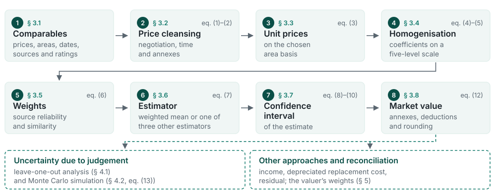
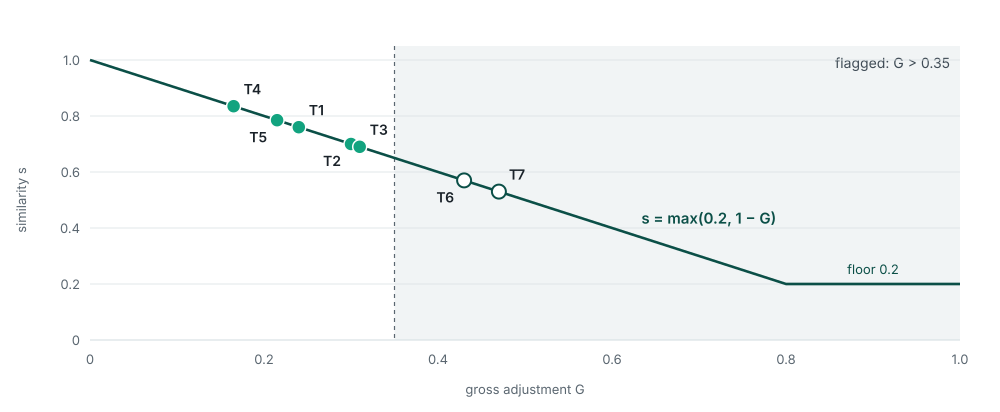
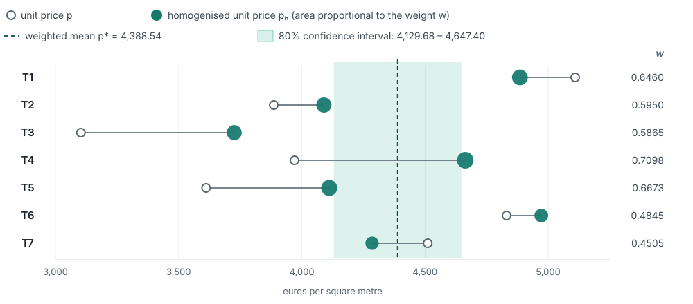
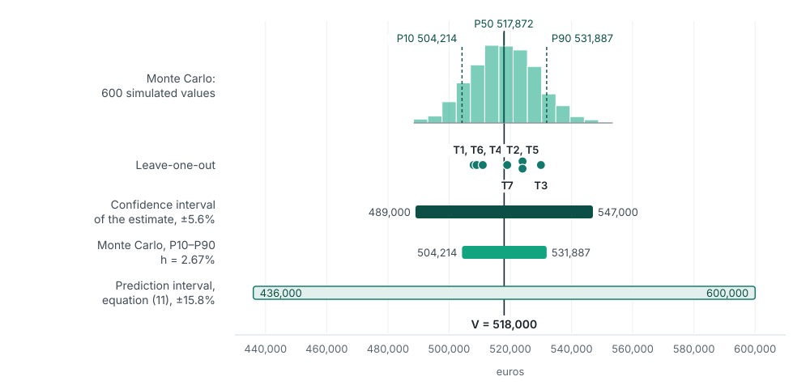

<p align="center">
  <picture>
    <source media="(prefers-color-scheme: dark)" srcset="../../../brand/valesta-logo-reverse.svg">
    
  </picture>
</p>

# Sales comparison with homogenisation coefficients: the valuation method of Valesta

**Domestone S.r.l.** · Technical paper · Draft for technical review, 24 November 2026

Copyright (C) 2026 Domestone S.r.l. This paper is part of the Valesta repository and is covered by its licence; see
[LICENSE](../../../LICENSE) and [NOTICE](../../../NOTICE).

The name Valesta and the logo belong to Domestone S.r.l. and are not covered by the AGPL-3.0 licence of the app; see
[TRADEMARK_POLICY.md](../../../TRADEMARK_POLICY.md).

## Abstract

Valesta is an open-source application for the valuation of residential and other property. Its main method is a sales
comparison in which the differences between the subject and each comparable are expressed as multiplicative
homogenisation coefficients on an ordinal five-level scale. This paper sets out the method formally: the cleansing of
comparable prices (negotiation, time and annexes), the homogenisation of unit prices, the weighting of comparables by
source reliability and similarity, the choice of estimator, the confidence interval of the estimate with an effective
sample size, and the conversion of the unit value into a market value. It then describes how Valesta reports the
uncertainty that comes from the valuer's judgement, with a leave-one-out analysis and a Monte Carlo simulation over
the judgement inputs, and how other approaches are reconciled. A synthetic worked example, computed by the code
described, shows every step. The paper relates the method to the international and national standards and to hedonic
price theory, and states its limits: the default coefficients are expert values that are not calibrated on market
data, the ratings are ordinal and partly judgemental, and the confidence interval measures the precision of the
estimate, not the range of prices at which the property could sell.

**Keywords:** property valuation; sales comparison approach; market approach; homogenisation coefficients; adjustment
grid; hedonic prices; effective sample size; valuation uncertainty; Monte Carlo simulation.

## 1. Introduction

The market approach estimates value by comparison with prices of similar properties. The International Valuation
Standards list it among the valuation approaches (IVS 103, *Valuation Approaches*) [IVSC-2025], the RICS Red Book
states that it aligns with those standards [RICS-RB-2025], and the European Valuation Standards are published by
TEGoVA [TEGOVA-EVS-2025]. How far these standards constrain the technique of adjustment must be checked on their texts
(content to be verified); national practice, in any case, differs: the Spanish order on valuations for
financial purposes requires homogenisation with justified criteria, coefficients and weights, on information from at
least six transactions or offers [ES-ECO805]; the German valuation regulation adjusts comparison prices with indices
and conversion coefficients derived from purchase prices [DE-IMMOWERTV]; in Italy the name «market comparison approach»
is commonly given to an adjustment by marginal prices of the characteristics [IT-UNI11612] [IT-CVI] (to be checked on
the texts, which are paywalled).

Valesta implements one comparison technique, which we call *sales comparison with homogenisation coefficients*. Each
difference between the subject and a comparable is rated on a five-level scale and turned into a coefficient; the
product of the coefficients homogenises the comparable's unit price; a weighted estimator of the homogenised prices
gives the unit value. The technique is close to the homogenisation of the Spanish order and has the structure of the
German comparison method, but its coefficients are expert defaults, not estimates from market data.

The contribution of this paper is a complete and checkable statement of the method: every formula is given with its
parameters, every threshold is named as a convention when it is one, and every number of the worked example is
produced by the published code. The software, its tests and a longer technical documentation are available in the
same repository (see *Reproducibility*).

Section 2 summarises the background. Section 3 defines the model. Section 4 describes the analysis of the uncertainty
due to judgement, and section 5 the other approaches and their reconciliation. Section 6 is the worked example.
Section 7 discusses the properties, the limits and the calibration of the method, and section 8 concludes.

> **A note on sources.** Every reference cited carries, in the Valesta bibliography, the date and the scope of its
> verification. Where a statement rests on a source whose content could not be checked on the text (only its
> bibliographic data were), it is marked «content to be verified».

## 2. Background

### 2.1 Adjustment methods

[PAGOURTZI-2003] reviews the main valuation methods. Within the comparison approach, three ways of handling the
differences between properties are relevant here.

- **Adjustment grids.** In United States practice the sales comparison approach adjusts each comparable's price for
  each element of comparison and reconciles the adjusted prices; comparables that need smaller adjustments are
  generally given more weight [AI-ARE-16] (content to be verified).
- **Coefficients.** The Spanish order homogenises comparables by «criterios, coeficientes y/o ponderaciones», which
  must be justified (art. 22.1.d) [ES-ECO805]; the German regulation uses conversion coefficients (§ 19) and indices
  (§ 18) derived by official bodies from purchase prices [DE-IMMOWERTV].
- **Hedonic prices.** Hedonic theory treats a property as a bundle of characteristics and estimates the implicit price of each from observed prices [ROSEN-1974] (content to be verified). A log-linear hedonic model, ln P = α + Σ<sub>j</sub> β<sub>j</sub>
  x<sub>j</sub> + ε, implies that two properties differing by Δx<sub>j</sub> in characteristic j have prices in the
  ratio exp(β<sub>j</sub> Δx<sub>j</sub>).

Valesta's coefficients can be read as a first-order version of the hedonic ratio (section 3.4), with the difference
that their slopes are fixed in advance rather than estimated.

### 2.2 Valuation uncertainty

Valuation uncertainty is the doubt about the figure reported at the valuation date, which the literature distinguishes
from the variation between valuers and over time [FRENCH-GABRIELLI-2004] (content to be verified). Statistical
dispersion of the comparables is only one of its sources; the inputs set by the valuer are another. Valesta reports the
first with a confidence interval (section 3.7) and the second with a sensitivity analysis (section 4).

## 3. The model

### 3.1 Data and notation

The valuation has a subject, with reference area S<sub>0</sub>, and n comparables i = 1, …, n that the valuer has
retained. Each comparable has a price P<sub>i</sub>, an area S<sub>i</sub>, a date, a source and the ratings
n<sub>ij</sub> of J factors j = 1, …, J. Valesta's default list has J = 12 factors (Appendix A). The valuer sets:
a negotiation coefficient, an annual time trend g, the values of the annexes (parking space and storage room), the
weight δ<sub>j</sub> of each factor, the reliability f of each source, the estimator, the confidence level and the
rounding step.



**Figure 1.** The steps of the method, with the sections and the equations that describe them; below, the analyses of
sections 4 and 5.

### 3.2 Price cleansing

Each price is turned into the probable price of the dwelling alone at the valuation date:

```math
P'_i = P_i \cdot K_{\mathrm{neg},i} \cdot K_{t,i} - A_i \qquad (1)
```

- **Negotiation K<sub>neg,i</sub>.** The comparable's own coefficient when the valuer sets one; otherwise 1 for
  closing prices (land registry, notary, closed sales) and, for asking prices, the valuation's default, which is 1 when
  none is set. Valesta does not estimate this coefficient: it is an input of the valuer, whose reasoning the report
  prints.
- **Time K<sub>t,i</sub>.** A compound trend over the months m<sub>i</sub> ≥ 0 between the comparable's date and the
  valuation date, with months of 30.4375 days and g limited to [−0.5, 0.5]:

```math
K_{t,i} = (1 + g)^{m_i / 12} \qquad (2)
```

- **Annexes A<sub>i</sub>.** The values of the parking space and storage room included in the comparable's price, so
  that dwellings are compared with dwellings; the subject's own annexes are added back in section 3.8.

Updating comparison prices to the valuation date with an index is also the technique of the German regulation
(§ 9(1) and § 18) [DE-IMMOWERTV].

### 3.3 Unit prices and area basis

```math
p_i = \frac{P'_i}{S_i} \qquad (3)
```

The area basis is the built area, the built area with common parts, or the usable area. When a comparable lacks the
area of the chosen basis, it is derived from the other with a built-to-usable ratio (1.18 by default). The subject's area S<sub>0</sub> is on the same basis; with the built area with common parts, the comparables' areas are taken as recorded, and the valuer must make sure that they are on the same basis.

### 3.4 Homogenisation coefficients

The valuer rates each factor on the scale n<sub>ij</sub> ∈ {−2, −1, 0, +1, +2}: positive when the subject is better
than the comparable, so that the comparable's price is adjusted upwards. Valesta can suggest ratings from the data
(area, floor, lift, age, condition, layout, orientation, outdoor space, services, communal areas, energy class), but
never for location, and the valuer's justified ratings prevail. With the weight δ<sub>j</sub> of factor j:

```math
k_{ij} = 1 + n_{ij} \cdot \delta_j, \qquad K_i = \prod_j k_{ij}, \qquad p_{h,i} = p_i \cdot K_i \qquad (4)
```

δ<sub>j</sub> is kept in [0, 0.25], so each k<sub>ij</sub> lies in [0.5, 1.5]. With the default weights (Appendix A),
K<sub>i</sub> ranges from 0.4195 (every rating −2) to 2.2172 (every rating +2). The product makes the order of the
factors irrelevant and keeps K<sub>i</sub> positive; its cost is that corrections compound (two +5% corrections give
+10.25%).

**Relation with hedonic prices.** Taking logarithms,

```math
\ln K_i = \sum_j \ln(1 + n_{ij}\,\delta_j) \approx \sum_j n_{ij}\,\delta_j \qquad (5)
```

which is the hedonic ratio of section 2.1 with Δx<sub>ij</sub> = n<sub>ij</sub> measured on an ordinal scale and
β<sub>j</sub> = δ<sub>j</sub> per step. The analogy makes clear what δ<sub>j</sub> is: an assumed implicit price of one
step of the scale, in relative terms. In hedonic practice it would be estimated from transactions [ROSEN-1974] (content to be verified); the
German conversion coefficients are derived by official bodies from purchase prices (§ 19) [DE-IMMOWERTV]. In Valesta
the defaults are expert values written in the code; the report states for each δ<sub>j</sub> whether it is Valesta's
default or set by the valuer, and the valuer's source.

### 3.5 Weights

Comparables that need smaller adjustments carry more information about the subject. Valesta measures the adjustment by
the gross adjustment G<sub>i</sub> and weights each comparable by the reliability f<sub>i</sub> of its source and its
similarity s<sub>i</sub>:

```math
G_i = \sum_j \lvert k_{ij} - 1 \rvert = \sum_j \lvert n_{ij} \rvert\,\delta_j, \qquad s_i = \max(0.2,\ 1 - G_i), \qquad w_i = f_i \cdot s_i \qquad (6)
```

The default reliabilities are 1.00 for land-registry, notarial and closed sales, 0.95 for agency mandates, 0.85 for
portal listings and 0.80 for other sources. The similarity falls linearly with G<sub>i</sub> and reaches its floor of
0.2 at G<sub>i</sub> = 0.8; a comparable whose gross adjustment exceeds 35% is flagged. Weights and thresholds are
Valesta's conventions. The Spanish order requires the weighting of comparables to be justified and each weight to be
stated (art. 22.1.d) [ES-ECO805]; the report prints every weight.



**Figure 3.** The similarity s as a function of the gross adjustment G, equation (6), with the seven comparables of the
example of section 6; a comparable with G above 0.35 is flagged.

### 3.6 Estimators

The unit value p\* is one of four estimators of the homogenised prices, the weighted mean being the default:

```math
p^{*} = \frac{\sum_i w_i\, p_{h,i}}{\sum_i w_i} \qquad (7)
```

The alternatives are the arithmetic mean, the median and the trimmed mean, which removes ⌊n·t/2⌋ values from each
tail as the TRIMMEAN spreadsheet function does [MS-TRIMMEAN]. The technical report shows the value under every estimator, and the result text states the largest difference between the arithmetic mean, the median and the weighted mean.

### 3.7 Dispersion and the confidence interval of the estimate

The dispersion of the homogenised prices is measured by the sample standard deviation s and the coefficient of
variation CV = s / x̄. The reliability class is high when CV ≤ 10% and n ≥ 6, medium when CV ≤ 15%, and low otherwise;
these thresholds are conventions, the sample of six being the minimum of the Spanish order (art. 21.1.c) [ES-ECO805].

For the weighted estimator, unequal weights reduce the information of the sample. Valesta uses the effective sample
size of Kish [KISH-1965] (content to be verified) and the weighted variance with the correction for reliability
weights of the GNU Scientific Library [GSL-WSTATS]:

```math
n_{\mathrm{eff}} = \frac{\left(\sum_i w_i\right)^2}{\sum_i w_i^2} \qquad (8)
```

```math
s_w^2 = \frac{\sum_i w_i\,(p_{h,i} - p^{*})^2}{\sum_i w_i - \sum_i w_i^2 / \sum_i w_i} \qquad (9)
```

The confidence interval of the estimate at level 1 − α uses Student's t distribution [STUDENT-1908] with
ν = max(1, ⌊n<sub>eff</sub> − 1⌋) degrees of freedom:

```math
p^{*} \pm h, \qquad h = t_{1-\alpha/2,\,\nu} \cdot \frac{s_w}{\sqrt{n_{\mathrm{eff}}}} \qquad (10)
```

For the other estimators, h = t<sub>1−α/2, n−1</sub> · s / √n, centred on the chosen estimator; for the median and the
trimmed mean this is an approximation, which the report states. The critical values are tabulated for 1 to 30 degrees
of freedom; beyond 30, the normal quantiles are used.

> **What the interval means.** Under the assumptions of independent, approximately normal homogenised prices with weights
> treated as fixed, the procedure covers the mean homogenised unit price of the market segment with probability
> 1 − α. It measures the precision of the estimate. It is *not* the range in which the subject's price would fall: that
> would be a prediction interval, with half-width of about
>
> ```math
> h_{\mathrm{pred}} \approx t_{1-\alpha/2,\,\nu} \cdot s_w \cdot \sqrt{1 + \frac{1}{n_{\mathrm{eff}}}} \qquad (11)
> ```
>
> which is wider by the factor √(n<sub>eff</sub> + 1) (section 6). Nor does the interval contain the market value
> «with probability 1 − α»: in the frequentist sense the probability belongs to the procedure, not to one interval. The
> report therefore calls it the *confidence interval of the estimate*. The interval also ignores the uncertainty of the
> inputs set by the valuer, which section 4 addresses.

### 3.8 From unit value to market value

```math
V = \mathrm{round}\left(p^{*} \cdot S_0 + A_0 - D;\ r\right) \qquad (12)
```

where A<sub>0</sub> is the value of the subject's annexes, D the deductions listed by the valuer (for example the cost
of regularising an installation) and r the rounding step of the valuation. The bounds of the interval of
equation (10) are converted in the same way, and are shown only when the sales comparison enters the value. The
listing price is V × (1 + m), rounded to five rounding steps, where m is the margin chosen by the valuer: it is a
marketing recommendation, not a value. The basis of value is market value as defined by the International Valuation
Standards (IVS 102, *Bases of Value*) [IVSC-2025].

## 4. Analysis of the uncertainty due to judgement

### 4.1 Leave-one-out

For each comparable i in use, the valuation is recomputed without it, and the relative change
Δ<sub>i</sub> = (V<sub>−i</sub> − V) / V is reported. A large |Δ<sub>i</sub>| shows that the value leans on one
comparable. Because rounded values are compared, the changes move in steps of one rounding step.

### 4.2 Monte Carlo simulation of the judgement inputs

The Monte Carlo method studies the output of a model by random sampling of its inputs [METROPOLIS-ULAM-1949] (content to be verified); the
metrological guide JCGM 101:2008 describes the propagation of input distributions through a model in this way
[JCGM-101-2008]. Valesta applies the technique to the inputs that the valuer sets. In each iteration r = 1, …, N,
independently and uniformly:

- the negotiation coefficient moves within ±0.02 of its value;
- the time trend is multiplied by a factor in [0.5, 1.5];
- each annex value is multiplied by a factor in [0.85, 1.15];
- each δ<sub>j</sub> is multiplied by a factor in [0.8, 1.2];
- each rating moves by one level, up or down with equal probability, with probability 0.1, within [−2, 2].

The whole valuation is recomputed, giving V<sup>(r)</sup> before rounding. Valesta reports the mean, the standard
deviation and the percentiles P05, P10, P50, P90 and P95 of the simulated values, with linear interpolation between
order statistics (definition 7 of [HYNDMAN-FAN-1996], content to be verified), and the spread

```math
h_{\mathrm{MC}} = \frac{\mathrm{P90} - \mathrm{P10}}{2\,V} \qquad (13)
```

The report uses N = 600 and a fixed seed of a deterministic pseudo-random generator, so that the same valuation always
gives the same figures. The estimate is classed as robust when max |Δ<sub>i</sub>| ≤ 3% and h<sub>MC</sub> ≤ 5%,
moderately sensitive when max |Δ<sub>i</sub>| ≤ 6% and h<sub>MC</sub> ≤ 10%, and sensitive to the assumptions
otherwise.

The ranges and thresholds are conventions of Valesta, not distributions estimated from data. The simulation is
therefore a sensitivity analysis in the form of JCGM 101 rather than a measurement of uncertainty in its sense (content to be verified), and the report states that it is not a declaration of material valuation uncertainty.

### 4.3 Three measures, three questions

| Measure | Question |
|---|---|
| Confidence interval of the estimate | How precise is the central estimate, given the dispersion of the homogenised sample? |
| Leave-one-out | Does the value depend on one comparable? |
| Monte Carlo | How much does the value move when the judgement inputs vary within the stated ranges? |

None of them covers errors in the data, the choice of the comparables or the choice of the method.

## 5. Other approaches and reconciliation

For properties whose value rests on income or cost, Valesta computes three further approaches with the valuer's
inputs:

- **income capitalisation:** V<sub>I</sub> = 12 R (1 − v)(1 − c) / y, with monthly rent R, vacancy v, operating costs
  c and capitalisation rate y;
- **depreciated replacement cost:** V<sub>C</sub> = L + S · u · (1 + φ)(1 + π)(1 − d), with land value L, unit cost u,
  fees φ, developer's profit π and depreciation d;
- **residual:** V<sub>R</sub> = GDV − B − φB − ρ(B + φB) − πGDV − σGDV, with gross development value GDV, building cost
  B, fees φ, finance ρ, profit π and sale costs σ.

The values are reconciled by the valuer's weights, normalised over the approaches in use, and the valuer's reasoning
is printed. The international standards and the US literature are understood to expect an explanation of the weight
given to each indication [IVSC-2025] [AI-ARE-16] (content to be verified). The discounted cash flow and the profits
method, usual for some property types, are not computed; the report names them when they apply.

## 6. Worked example

The example is the demo valuation of Valesta, which is synthetic. The subject is a flat of 113 m² built, with a
parking space and a storage room; the valuation date is 22 November 2026; the settings are the weighted estimator, an
80% confidence level, a negotiation coefficient of 0.94 and annex values of 18,000 and 4,000. The amounts are in
euros, and the figures are those computed by the code (rounded half up for display).

**Table 1.** Comparables in use: price P, area S, negotiation coefficient, annex deduction A, unit price p, total
coefficient K, gross adjustment G, weight w and homogenised unit price p<sub>h</sub>.

| Id | P | S (m²) | K<sub>neg</sub> | A | p | K | G | w | p<sub>h</sub> |
|---|---:|---:|---:|---:|---:|---:|---:|---:|---:|
| T1 | 579,000 | 103 | 0.94 | 18,000 | 5,109.32 | 0.9561 | 0.24 | 0.6460 | 4,884.96 |
| T2 | 412,000 | 94 | 0.94 | 22,000 | 3,885.96 | 1.0524 | 0.30 | 0.5950 | 4,089.63 |
| T3 | 274,000 | 83 | 0.94 | 0 | 3,103.13 | 1.2006 | 0.31 | 0.5865 | 3,725.67 |
| T4 | 488,000 | 110 | 0.94 | 22,000 | 3,970.18 | 1.1746 | 0.165 | 0.7098 | 4,663.26 |
| T5 | 557,000 | 140 | 0.94 | 18,000 | 3,611.29 | 1.1384 | 0.215 | 0.6673 | 4,111.20 |
| T6 | 641,000 | 121 | 0.94 | 18,000 | 4,830.91 | 1.0292 | 0.43 | 0.4845 | 4,971.91 |
| T7 | 474,500 | 94 | 0.94 | 22,000 | 4,510.96 | 0.9499 | 0.47 | 0.4505 | 4,285.04 |

All seven are portal asking prices dated on the valuation date, so K<sub>t</sub> = 1 and f = 0.85. For T1:
P′ = 579,000 × 0.94 − 18,000 = 526,260; p = 526,260 / 103 = 5,109.32; seven ratings give K = 0.9561 and
G = 0.24; s = 0.76 and w = 0.85 × 0.76 = 0.6460; p<sub>h</sub> = 4,884.96. Two further comparables were excluded by
the valuer and are reported as references.

**Table 2.** Statistics and value.

| Quantity | Value |
|---|---:|
| Mean / median / weighted mean | 4,390.24 / 4,285.04 / 4,388.54 |
| s / CV | 461.63 / 10.51% |
| n<sub>eff</sub> / s<sub>w</sub> | 6.8488 / 458.97 |
| ν / t (80%) | 5 / 1.476 |
| Confidence interval of the unit value | 4,129.68 – 4,647.40 |
| Market value: 4,388.54 × 113 + 22,000, rounded to 1,000 | 518,000 |
| Confidence interval of the estimate, in value | 489,000 – 547,000 (±5.6%) |
| Prediction interval, equation (11), for comparison | 436,000 – 600,000 (±15.8%) |

The coefficient of variation of 10.51% gives a medium reliability class, and T6 and T7 are flagged for gross
adjustments above 35%. The three estimators differ by at most 2.5%, the median being the lowest.



**Figure 2.** Unit price p (open circle) and homogenised unit price p<sub>h</sub> (filled circle, with its area
proportional to the weight w) of the seven comparables. The dashed line is the weighted mean p\* and the band is the
confidence interval of the unit value (Table 2).

**Table 3.** Analysis of the uncertainty due to judgement (600 iterations, fixed seed).

| Leave-one-out | Δ<sub>i</sub> | | Monte Carlo | Value |
|---|---:|---|---|---:|
| T1 | −1.93% | | Mean | 518,033 |
| T2 | +1.16% | | Standard deviation | 10,592 (CV 2.04%) |
| T3 | +2.32% | | P10 | 504,214 |
| T4 | −1.35% | | P50 | 517,872 |
| T5 | +1.16% | | P90 | 531,887 |
| T6 | −1.74% | | h<sub>MC</sub> | 2.67% |
| T7 | +0.19% | | | |

The largest change, 2.32% without T3, and the spread of 2.67% class the estimate as robust by Valesta's thresholds.
The example illustrates the different questions of section 4.3: the confidence interval of the estimate (±5.6%), the
spread due to judgement (±2.67%) and the prediction interval (±15.8%) are not interchangeable.



**Figure 4.** The market value of the example with the measures of section 4.3 on one scale: the distribution of the
600 simulated values with the percentiles P10, P50 and P90, the values obtained leaving out one comparable at a time,
the confidence interval of the estimate, the P10–P90 spread and, for comparison, the prediction interval of
equation (11).

## 7. Discussion

### 7.1 Properties

The method is transparent: each step is a closed formula whose inputs are printed, every coefficient and weight can
be traced, and the adjustment table of the report has the comparables in columns and the factors in rows, as in an
adjustment grid. It is reproducible: the engine is a pure function of the valuation file, and the simulation uses a
fixed seed. It is robust to the order of the factors and keeps prices positive. Its weighting rewards similar
comparables without discarding dissimilar ones, and its uncertainty analysis separates the dispersion of the sample
from the sensitivity to judgement.

### 7.2 Limits

- **The default δ are not calibrated.** They are a professional starting point, which the valuer should review for
  each market; the report shows which values are defaults.
- **The ratings are ordinal and partly judgemental.** The scale treats the distance between levels as constant, and
  location is entirely the valuer's judgement.
- **The coefficients are independent.** Interactions between characteristics are captured only through the product.
- **The negotiation coefficient and the time trend are inputs, not estimates.**
- **The confidence interval rests on simplifying assumptions:** independence, approximate normality, weights treated
  as fixed, a rule of thumb for the degrees of freedom, and the mean's half-width for the median and the trimmed mean.
- **The method does not adjust for property rights, financing or conditions of sale**, beyond the negotiation
  coefficient and the choice of comparables.
- **Thresholds are conventions.** Only the minimum of six comparables has an external source, the Spanish order.

The International Valuation Standards include a standard on valuation models (IVS 105) [IVSC-2025]; whether Valesta's
documentation meets it must be checked against the text. Conformity of a report with the standards is a statement of
its signatory, not a property of the software.

### 7.3 Calibration and validation

The analogy of equation (5) suggests how δ could be calibrated for a market: by a log-linear hedonic regression of
transaction prices on the characteristics, with the ordinal ratings or their underlying measures as regressors [ROSEN-1974] (content to be verified), or by conversion coefficients published by official bodies where they exist [DE-IMMOWERTV]. Expert
defaults could then serve as prior values, revised as local evidence accumulates. Independently of calibration, the
method should be validated by comparing its values with later transaction prices of the properties valued. Both are
outside the scope of this version and are left to the roadmap.

## 8. Conclusions

Sales comparison with homogenisation coefficients is a compact and transparent form of the market approach: it
expresses each difference between the subject and a comparable as a coefficient on an ordinal scale, weights
comparables by source and similarity, and reports both the precision of the estimate and its sensitivity to the
valuer's inputs. Its strength is that every number can be explained and reproduced; its main weakness is that the
coefficients are assumptions until they are calibrated on market data. Stating both, as this paper does, is a
condition for using the method responsibly.

## Reproducibility

Valesta is free software under the GNU Affero General Public License, version 3 or later. The method is implemented in
`src/js/engine.js`; the report in `src/js/report.js`; the facts of the method applied in each valuation in
`src/js/method.js`; the references with their verification status in `src/js/references.js`. The figures of section 6
are those of the demo valuation in `src/js/data.js`, and the test `tests/methodology-docs.test.js` checks them against
the engine. A longer technical documentation, with a reference to the code for every rule, is in `docs/methodology/`.

## References

The status after each reference is that of the Valesta bibliography (`docs/methodology/5-bibliography.md`).

- **[AI-ARE-16]** Appraisal Institute (2026). *The Appraisal of Real Estate*, 16th edition. Chicago: Appraisal
  Institute. ISBN 978-1-935328-98-8. — bibliographic data verified 2026-11-24.
- **[DE-IMMOWERTV]** Immobilienwertermittlungsverordnung vom 14. Juli 2021 (BGBl. I S. 2805), in force 1 January 2022.
  — content verified 2026-11-24.
- **[ES-ECO805]** Orden ECO/805/2003, de 27 de marzo, sobre normas de valoración de bienes inmuebles y de determinados
  derechos para ciertas finalidades financieras. BOE núm. 85, 9 April 2003; consolidated text, last updated 12 June
  2025. — content verified 2026-11-24.
- **[FRENCH-GABRIELLI-2004]** French, N.; Gabrielli, L. (2004). The uncertainty of valuation. *Journal of Property
  Investment & Finance* 22(6), 484–500. doi:10.1108/14635780410569470. — bibliographic data verified 2026-11-24.
- **[GSL-WSTATS]** GNU Scientific Library 2.8 documentation, Statistics – Weighted Samples, function
  gsl_stats_wvariance. — content verified 2026-11-24.
- **[HYNDMAN-FAN-1996]** Hyndman, R.J.; Fan, Y. (1996). Sample Quantiles in Statistical Packages. *The American
  Statistician* 50(4), 361–365. doi:10.1080/00031305.1996.10473566. — bibliographic data verified 2026-11-24.
- **[IT-CVI]** Tecnoborsa. *Codice delle Valutazioni Immobiliari – Italian Property Valuation Standard*. — bibliographic
  data verified 2026-11-24.
- **[IT-UNI11612]** UNI. UNI 11612:2015 *Stima del valore di mercato degli immobili*, in force since 10 December 2015.
  — bibliographic data verified 2026-11-24.
- **[IVSC-2025]** International Valuation Standards Council. *International Valuation Standards*, effective
  31 January 2025 (published January 2024). London: IVSC. ISBN 978-0-9931513-7-8. — bibliographic data verified
  2026-11-24 (titles of the standards checked).
- **[JCGM-101-2008]** Joint Committee for Guides in Metrology (2008). *JCGM 101:2008 Evaluation of measurement data –
  Supplement 1 to the «Guide to the expression of uncertainty in measurement» – Propagation of distributions using a
  Monte Carlo method*, first edition. BIPM. doi:10.59161/JCGM101-2008. — bibliographic data verified 2026-11-24.
- **[KISH-1965]** Kish, L. (1965). *Survey Sampling*. New York: John Wiley & Sons (reprinted 1995, ISBN
  978-0-471-10949-5). — bibliographic data verified 2026-11-24.
- **[METROPOLIS-ULAM-1949]** Metropolis, N.; Ulam, S. (1949). The Monte Carlo Method. *Journal of the American
  Statistical Association* 44(247), 335–341. doi:10.1080/01621459.1949.10483310. — bibliographic data verified
  2026-11-24.
- **[MS-TRIMMEAN]** Microsoft Support. TRIMMEAN function. — content verified 2026-11-24.
- **[PAGOURTZI-2003]** Pagourtzi, E.; Assimakopoulos, V.; Hatzichristos, T.; French, N. (2003). Real estate
  appraisal: a review of valuation methods. *Journal of Property Investment & Finance* 21(4), 383–401.
  doi:10.1108/14635780310483656. — bibliographic data verified 2026-11-24.
- **[RICS-RB-2025]** Royal Institution of Chartered Surveyors. *RICS Valuation – Global Standards* («Red Book»), 2025
  edition, effective 31 January 2025. — bibliographic data verified 2026-11-24.
- **[ROSEN-1974]** Rosen, S. (1974). Hedonic Prices and Implicit Markets: Product Differentiation in Pure
  Competition. *Journal of Political Economy* 82(1), 34–55. doi:10.1086/260169. — bibliographic data verified
  2026-11-24.
- **[STUDENT-1908]** Student (1908). The Probable Error of a Mean. *Biometrika* 6(1). doi:10.1093/biomet/6.1.1. —
  bibliographic data verified 2026-11-24.
- **[TEGOVA-EVS-2025]** TEGoVA. *European Valuation Standards 2025*, tenth edition, effective 1 January 2025. —
  bibliographic data verified 2026-11-24.

## Appendix A. Default factors and rating scale

**Table A.1.** Default factors and weights δ per level; a rating of ±2 gives the maximum adjustment ±2δ.

| Factor | δ per level | Maximum |
|---|---:|---:|
| Location and surroundings | 7.5% | ±15% |
| Size | 3% | ±6% |
| Floor level | 3% | ±6% |
| Lift and accessibility | 5% | ±10% |
| Building age and type | 5% | ±10% |
| Condition and finishes | 5% | ±10% |
| Layout (bedrooms and bathrooms) | 3% | ±6% |
| Orientation, light and views | 2% | ±4% |
| Terraces and outdoor space | 3% | ±6% |
| Climate control and services | 2% | ±4% |
| Communal areas (pool, garden) | 2% | ±4% |
| Energy efficiency | 1% | ±2% |

**Table A.2.** Rating scale: the subject compared with the comparable.

| n | Meaning | k with δ = 5% |
|---:|---|---:|
| +2 | much better | 1.10 |
| +1 | better | 1.05 |
| 0 | similar | 1.00 |
| −1 | worse | 0.95 |
| −2 | much worse | 0.90 |
